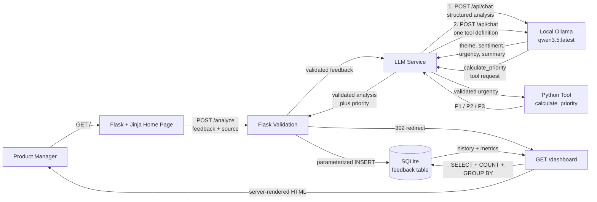

# Customer Empathy Analysis AI
## Product Requirements Document

| Document field | Value |
| --- | --- |
| Product | Customer Empathy Analysis AI |
| Implemented UI name | Customer Feedback Analyzer |
| Document type | As-built MVP PRD |
| Status | Current implementation |
| Last updated | July 25, 2026 |
| Primary audience | Product, Engineering, Design, AI/ML, QA |

> **Document intent:** This PRD describes the application as implemented in the
> repository. Proposed targets and future opportunities are explicitly labeled
> and should not be interpreted as current capabilities or measured results.

---

# 1. Executive Summary

## 1.1 Product vision

Enable Customer support channels/ Product Managers/ Business leads  to turn unstructured customer feedback into consistent,
actionable product signals / Product insights without manually reading, labeling, and summarizing
each item.

The MVP provides a focused workflow: a User/consumer submits one piece of feedback,
identifies its source learns about customer demographics, and receives four AI-generated attributes—theme,
sentiment, urgency of ticket/feedback, and a short summary—plus a deterministic business priority.  The original feedback and structured
analysis are stored locally and made available in an aggregate dashboard.


V2 : Build recommendation engine/ Generate insights based on the structured analysis 
V3: Monitoring dashboard : Product trends connecting back to feedback and changes  from recommmendation engine

Product Goal/Outcome :

Generate actionable product insights from summarizaton of customer reviews/support tickets 

## 1.2 Problem statement

Customer insight arrives through fragmented channels such as public reviews,
support tickets, and surveys. Product teams must repeatedly interpret this
unstructured text before they can answer basic prioritization questions; And usually managing and analying hundreds of reviews and struggle to identify recurring problems 

- What is the customer talking about?
- How does the customer feel?
- How urgent is the issue?
- What is the core point?
- Which themes and sentiments appear most often?
- What recommendations should we make to the product to change the reviews? 

Manual analysis is slow, inconsistent, and difficult to maintain as feedback
volume increases. Different reviewers may label the same feedback differently,
and the work of summarizing individual items competes with higher-value product
discovery and prioritization.

## 1.3 Opportunity

The immediate opportunity is to reduce the cognitive and administrative cost of
triaging individual feedback while establishing a structured dataset for later
analysis. The MVP validates the smallest useful loop:

1. Capture a feedback item.
2. Apply a consistent AI classification.
3. Persist the result.
4. Review individual history and aggregate counts.

The local Ollama architecture also provides a path for teams that prefer not to
send customer feedback to a hosted model provider during early prototyping.
This is an architectural characteristic of the implementation, not a claim of
enterprise-grade data isolation or compliance.

V2: Build the recommendation based on the summarized output result. For eg: change in product pricing, improve user experience or user journey 

## 1.4 Value proposition

**For Product Managers who need to make sense of feedback from multiple
channels, Customer Empathy Analysis AI converts a single raw feedback item into
consistent AI analysis plus a deterministic P1/P2/P3 priority and preserves the
result in a searchable dashboard. Unlike a manual spreadsheet workflow, the
product combines interpretation, controlled tool execution, persistence, and
basic aggregation in one local application.**

The delivered value is:

- Faster first-pass triage of qualitative feedback.
- More consistent sentiment and urgency labels.
- Concise summaries that reduce re-reading. 
- A persistent history of submitted feedback.
- Immediate visibility into feedback volume by theme and sentiment.

---

# 2. Goals

## 2.1 Business goals

The current repository does not include commercial, growth, or usage
instrumentation. The following are product goals appropriate to the MVP:

1. Validate that PMs find automated feedback triage useful enough to adopt in
   their regular discovery workflow.
2. Demonstrate that a local LLM can produce structured outputs reliably enough
   for an interactive single-item workflow.
3. Establish a simple, maintainable foundation for later batch ingestion,
   analytics, and team workflows.
4. Reduce time spent manually categorizing individual feedback items.

## 2.2 User goals

Users should be able to:

- Enter customer feedback without preprocessing it.
- Identify whether the feedback came from a review, support ticket, or survey.
- Receive an understandable classification in one interaction.
- Trust that invalid or incomplete analysis will not be saved.
- Review all previously analyzed feedback.
- Understand overall feedback volume and distribution.
- Narrow the dashboard by theme or sentiment.
- Sort results by time or urgency.

## 2.3 Success metrics

No analytics or evaluation framework is implemented today. The table below
defines **proposed MVP validation targets**, not current measurements.

| Dimension | Proposed metric | Initial target | Measurement approach |
| --- | --- | ---: | --- |
| Task success | Successful analyses / valid submissions | ≥95% | Application event logging |
| Structured-output reliability | Valid model responses on first attempt | ≥95% | Model response validation logs |
| Recovery | Valid responses after one JSON retry | ≥99% cumulative | Retry counter |
| User efficiency | Median time from paste to saved result | <30 seconds on reference hardware | Client/server timing |
| Quality | Human agreement with theme | ≥80% | Labeled evaluation set |
| Quality | Human agreement with sentiment | ≥85% | Labeled evaluation set |
| Quality | Human agreement with urgency | ≥80% | Labeled evaluation set |
| Quality | Summary judged accurate and useful | ≥80% | Human rubric |
| Adoption | Weekly active evaluators completing ≥3 analyses | Baseline during pilot | Product analytics |
| Retention | Evaluators returning in a subsequent week | Baseline during pilot | Product analytics |

Targets depend on the selected hardware, model version, feedback domain, and
human evaluation rubric. These inputs must be fixed before targets become
release criteria.

## 2.4 Out of scope

The following capabilities are intentionally not implemented:

- Authentication, authorization, accounts, or roles.
- Multi-user or team workspaces.
- CSV or file upload.
- Batch analysis.
- External feedback-source integrations.
- Retrieval-augmented generation (RAG).
- Additional tools, MCP, or agent workflows beyond the single
  `calculate_priority` function.
- Human editing or correction of AI labels.
- Deletion or modification of saved feedback.
- Exports or reporting.
- Time-series trend analysis.
- Theme normalization or taxonomy management.
- Search across feedback text.
- Pagination.
- Hosted deployment or production operations.
- Model selection or model comparison.
- Usage analytics, quality evaluation, or feedback on model output.
- Localization or explicit multilingual behavior.

---

# 3. Users

## 3.1 Primary personas

### Product Manager — primary user

**Job to be done:** When reviewing qualitative feedback, quickly identify the
underlying customer need, emotional signal, and urgency so that evidence can
inform discovery and prioritization.

**Needs:**

- A low-friction way to process one feedback item.
- Consistent categories across different feedback sources.
- A concise history that can be reviewed later.
- Aggregate signals without manual counting.

### Product Operations or Customer Insights Partner — secondary user

**Job to be done:** Structure incoming qualitative feedback so Product teams can
review it consistently.

The MVP can support this persona functionally, but does not provide batch
processing, collaboration, governance, or taxonomy controls that this role
would typically need.

### Support Lead — adjacent user

**Job to be done:** Surface recurring and urgent product problems from support
tickets.

The MVP accepts support tickets as a source and can sort by urgency, but it does
not integrate with a support platform or support operational workflows.

## 3.2 Customer pain points

- Feedback is distributed across channels and formats.
- Manual categorization is repetitive and time-consuming.
- Labels vary by reviewer.
- Long feedback must be re-read to recover its main point.
- High-urgency issues may be hidden among routine comments.
- Aggregate patterns are difficult to see without structured data.
- Cloud model use may be undesirable for early experiments with sensitive
  feedback.

These pain points are product hypotheses inferred from the implemented
workflow. The repository contains no user research artifacts or analytics that
validate prevalence or severity.

## 3.3 User journeys

### Journey A — Analyze one item

1. The user opens the Analyze page.
2. The user pastes or types customer feedback.
3. The user selects Review, Support Ticket, or Survey.
4. The user selects **Analyze feedback**.
5. The application validates the form.
6. The application asks the local model to classify the feedback.
7. The application validates the returned JSON.
8. The application saves the original feedback, source, and analysis.
9. The user is redirected to the dashboard and sees a success message.

### Journey B — Review feedback history

1. The user opens the Dashboard page.
2. The user reviews total feedback, top themes, and sentiment counts.
3. The user scans the table of stored feedback and analysis.
4. The user filters by exact theme or sentiment.
5. The user sorts newest first, oldest first, or by highest urgency.

### Journey C — Recover from an error

1. The user submits invalid input or analysis cannot be completed.
2. The application does not save a partial record.
3. The user is redirected to the Analyze page.
4. A friendly flash message identifies the next action where possible.
5. The user corrects the input or starts Ollama, then resubmits.

---

# 4. Current MVP Scope

## 4.1 Feedback submission

The home page provides:

- One required textarea for customer feedback.
- A browser-level maximum of 10,000 characters.
- One required source dropdown.
- Three allowed sources: Review, Support Ticket, and Survey.
- One submit action.

The server trims leading and trailing whitespace and independently enforces the
required text, maximum length, and source allowlist.

## 4.2 AI analysis

The application sends one feedback item at a time to a locally running Ollama
service using `qwen3.5:latest`. Generation is non-streaming, JSON-constrained,
temperature zero, and configured with thinking disabled.

## 4.3 Theme extraction

The model returns a short, reusable product theme. The prompt asks for two to
four words. Application validation requires a non-empty value no longer than 60
characters. There is no controlled theme taxonomy, canonicalization, fuzzy
matching, or duplicate-theme merging.

## 4.4 Sentiment classification

The model must select exactly one of:

- Positive
- Neutral
- Negative
- Mixed

The application rejects values outside this allowlist.

## 4.5 Urgency detection

The model must select exactly one of:

- Low
- Medium
- High

The prompt instructs the model to judge urgency from customer impact and time
sensitivity. The application rejects values outside the allowlist.

## 4.6 Priority tool calling

After analysis, Qwen is given exactly one function definition and instructed to
request `calculate_priority` once using the urgency it already selected. Python
validates the function name and arguments, executes the function, and maps:

- High to P1.
- Medium to P2.
- Low to P3.

The model is not given the mapping and does not calculate the priority.

## 4.7 Summary generation

The model produces a concise, one-sentence summary. The prompt requests no more
than 25 words. The application enforces a non-empty value and a 240-character
maximum, but does not deterministically count sentences or words.

## 4.8 SQLite persistence

Each successful analysis creates one row in a local SQLite database. The
database is initialized automatically when the Flask application starts. The
database path defaults to `feedback.db` and can be changed with
`DATABASE_PATH`.

No record is created if form validation, model access, JSON parsing, response
validation, or database persistence fails.

## 4.9 Dashboard

The dashboard displays:

- Total number of stored feedback records.
- Up to four highest-count themes.
- Counts for every sentiment currently present.
- A tabular view containing feedback, source, theme, sentiment, urgency,
  priority, and summary.
- The number of records shown after filtering.

Aggregate metrics are computed across the full database and do not change when
the table is filtered.

## 4.10 History

All successfully analyzed records are available in the dashboard table.
History can be:

- Filtered by an exact theme.
- Filtered by an exact sentiment.
- Filtered by theme and sentiment together.
- Sorted newest first.
- Sorted oldest first.
- Sorted by urgency using High, Medium, then Low. Historical Critical records
  created before this enhancement remain sortable first if present.

There is no pagination, full-text search, edit, delete, archival, or detail
page.

---

# 5. Functional Requirements

## FR-1 — Submit customer feedback

**Description:** Capture one unstructured feedback item and its source.

**Inputs:**

- `feedback`: required text, trimmed server-side, maximum 10,000 characters.
- `source`: required enum of Review, Support Ticket, or Survey.

**Outputs:**

- On valid analysis: one persisted record and redirect to Dashboard.
- On validation failure: redirect to Home with an error message.

**User flow:**

1. Enter feedback.
2. Select source.
3. Submit.
4. Wait for analysis.
5. Review the saved result on Dashboard.

**Edge cases:**

- Empty or whitespace-only feedback.
- Feedback longer than 10,000 characters.
- Missing or tampered source value.
- Duplicate submissions; duplicates are accepted as separate records.
- Browser resubmission behavior is mitigated by redirect-after-post.

**Acceptance criteria:**

- Given empty feedback, the record is not saved and the user sees “Please enter
  customer feedback.”
- Given feedback over 10,000 characters, the record is not saved and the user
  sees the length error.
- Given a source outside the allowlist, the record is not saved and the user
  sees a source validation error.
- Given valid feedback and source plus a valid AI response, exactly one row is
  persisted.

## FR-2 — Analyze feedback with a local LLM

**Description:** Convert the feedback into theme, sentiment, urgency, and
summary using Qwen 3.5 through local Ollama.

**Inputs:**

- Validated customer feedback text.
- Fixed system instructions.
- Fixed model identifier `qwen3.5:latest`.

**Outputs:**

- Parsed Python dictionary containing all four required fields.

**User flow:**

This operation runs synchronously after form submission. No result is displayed
until model generation, parsing, validation, and persistence finish.

**Edge cases:**

- Ollama is not installed or not running.
- Model has not been pulled.
- Request exceeds the 120-second HTTP timeout.
- Ollama returns an HTTP error.
- Ollama returns an unexpected envelope.
- Model response is invalid JSON.
- Model response is valid JSON but incomplete or outside allowed values.

**Acceptance criteria:**

- Requests are sent to `http://localhost:11434/api/chat`.
- The request uses `qwen3.5:latest`, non-streaming JSON mode, temperature 0, and
  `think: false`.
- No cloud API key is required.
- Only a response that passes application validation can be persisted.
- Ollama connectivity failures produce a friendly, actionable message.

## FR-3 — Extract theme

**Description:** Identify the primary reusable product topic in the feedback.

**Input:** Raw feedback text included in the model prompt.

**Output:** Non-empty theme string.

**User flow:** Theme appears as a badge in the Dashboard table and as a grouping
dimension in metrics and filtering.

**Edge cases:**

- Multiple topics in one item.
- Theme synonyms creating separate groups.
- Overly broad or overly specific themes.
- Theme longer than the application limit.

**Acceptance criteria:**

- Theme is present after trimming.
- Theme is no longer than 60 characters.
- Theme is saved unchanged after validation.
- Theme becomes available in the exact-match filter.

## FR-4 — Classify sentiment

**Description:** Assign a single sentiment label.

**Input:** Raw feedback text.

**Output:** Positive, Neutral, Negative, or Mixed.

**User flow:** Sentiment appears in the table, aggregate counts, and filter.

**Edge cases:**

- Feedback containing both praise and criticism.
- Factual feedback with little emotional language.
- Sarcasm or ambiguous language.

**Acceptance criteria:**

- Only the four allowed values are accepted.
- An invalid value prevents persistence.
- Mixed feedback can be represented without forcing a positive or negative
  label.

## FR-5 — Detect urgency

**Description:** Estimate how quickly the feedback should receive attention
based on impact and time sensitivity.

**Input:** Raw feedback text.

**Output:** Low, Medium, or High.

**User flow:** Urgency appears in the table and can control table ordering.

**Edge cases:**

- Strong emotional language without actual time sensitivity.
- Severe impact with no explicit deadline.
- Explicit deadline with limited impact.
- Model inconsistency across similar items.

**Acceptance criteria:**

- Only the three allowed values are accepted for new analyses.
- Sorting by urgency orders High, Medium, then Low for new analyses.
- Within the urgency sort, newer items appear first when urgency is equal.

## FR-6 — Request and execute the priority tool

**Description:** Ask Qwen to request the only available tool, validate the
request in Python, and convert urgency into a business priority.

**Input:** The validated urgency produced during analysis.

**Output:** P1 for High, P2 for Medium, or P3 for Low.

**User flow:** Tool calling is automatic after analysis. The resulting priority
appears in the Dashboard and is saved with the feedback record.

**Edge cases:**

- The model does not request a tool.
- The model requests more than one tool call.
- The model requests a different function name.
- The model changes the urgency in the tool arguments.
- The tool arguments contain missing or additional fields.
- Python receives an unsupported urgency.

**Acceptance criteria:**

- The only tool definition sent to Qwen is `calculate_priority`.
- The application accepts exactly one tool call.
- The function name must exactly equal `calculate_priority`.
- The arguments must contain only `urgency`.
- The requested urgency must equal the validated analysis urgency.
- Python, not the model, maps High to P1, Medium to P2, and Low to P3.
- An invalid tool request prevents persistence and displays a friendly error.

## FR-7 — Generate a concise summary

**Description:** Restate the central customer need or issue in one concise
sentence.

**Input:** Raw feedback text.

**Output:** Non-empty summary string.

**User flow:** Summary appears in the last column of the Dashboard table.

**Edge cases:**

- Long, multi-topic feedback.
- Model adds unsupported details.
- Summary exceeds the prompted word count but remains under 240 characters.

**Acceptance criteria:**

- Summary is present after trimming.
- Summary does not exceed 240 characters.
- Prompt requests one sentence and no more than 25 words.
- Application does not claim deterministic enforcement of sentence or word
  count.

## FR-8 — Validate AI output

**Description:** Protect persistence and downstream dashboard logic from
malformed or out-of-contract model responses.

**Inputs:** Model-generated response string.

**Outputs:** Validated dictionary or `AnalysisError`.

**User flow:** Validation is invisible on success. On failure, the user returns
to Home with a friendly message.

**Edge cases:**

- Invalid JSON syntax.
- JSON array instead of object.
- Missing required property.
- Empty value.
- Invalid enum.
- Excessively long theme or summary.
- Additional properties; these are tolerated but not persisted.

**Acceptance criteria:**

- All four required properties must exist.
- Persisted values are converted to strings and trimmed.
- Invalid sentiment or urgency is rejected.
- Invalid JSON triggers exactly one retry.
- Schema-valid but semantically invalid data does not trigger the JSON retry.

## FR-9 — Persist analyzed feedback

**Description:** Save the original input and validated model output in SQLite.

**Inputs:** Feedback, source, theme, sentiment, urgency, priority, summary.

**Outputs:** One committed row.

**User flow:** Persistence occurs before redirecting to Dashboard.

**Edge cases:**

- Database file does not exist.
- Configured parent directory does not exist.
- Database is locked or not writable.
- Application terminates between analysis and commit.

**Acceptance criteria:**

- Table creation is idempotent at application startup.
- Inserts use parameterized SQL.
- Each successful submission commits one row.
- Connections are closed after each operation.
- A database exception produces the generic failure message and is logged with
  a stack trace.

## FR-10 — Display dashboard metrics

**Description:** Summarize the complete persisted dataset.

**Inputs:** All rows in `feedback`.

**Outputs:**

- Total row count.
- Counts grouped by theme.
- Counts grouped by sentiment.
- Distinct theme list for filtering.

**User flow:** Metrics load on every Dashboard request.

**Edge cases:**

- Empty database.
- More than four themes; only four are shown in the theme card.
- Tied counts; ties are alphabetized.
- Filtered table; metrics remain global.

**Acceptance criteria:**

- Total equals the number of persisted rows.
- Theme and sentiment counts are computed by SQLite, not the model.
- Empty-state copy appears when no metric data exists.

## FR-11 — Browse, filter, and sort history

**Description:** Display and narrow all analyzed feedback.

**Inputs:**

- Optional `theme` query parameter.
- Optional `sentiment` query parameter.
- Optional `sort` query parameter.

**Outputs:** HTML table of matching rows.

**User flow:** Select filters and sort order, then select Apply.

**Edge cases:**

- Unknown theme or valid-but-absent sentiment returns no rows.
- Unknown sort value safely falls back to newest first.
- Query parameters are not used to construct SQL identifiers or fragments
  directly.
- Large history may produce a long page because pagination is absent.

**Acceptance criteria:**

- Theme and sentiment filters can be combined.
- Filter values are passed as parameterized query arguments.
- Sorting uses only an application-owned allowlist of SQL order clauses.
- An empty result renders a clear empty state.

---

# 6. AI Design

## 6.1 Why an LLM is needed

Theme extraction, sentiment classification, urgency assessment, and concise
summarization require contextual language understanding. Keyword rules would be
fragile when feedback includes:

- Multiple clauses or mixed sentiment.
- Implicit customer impact.
- Deadlines and contextual urgency.
- Varied wording for the same product topic.
- Long descriptions that must be compressed without losing the main point.

The LLM is used only for these probabilistic interpretation tasks.

## 6.2 Model responsibilities

The model is responsible for:

- Understanding the semantic meaning of one feedback item.
- Selecting a short theme.
- Classifying sentiment into the defined enum.
- Assessing urgency into the defined enum.
- Writing a concise summary.
- Returning only JSON that matches the requested shape.
- Requesting the provided `calculate_priority` tool with the urgency it selected.

The model is explicitly told not to invent facts or expose commentary and
reasoning outside the JSON. It is not responsible for mapping urgency to
P1/P2/P3.

## 6.3 Deterministic application responsibilities

Python and SQLite—not the model—are responsible for:

- Input validation.
- Source validation.
- HTTP request construction.
- JSON parsing.
- Schema and enum validation.
- Tool-name and tool-argument validation.
- Execution of `calculate_priority`.
- Deterministic mapping from urgency to priority.
- Retry control.
- Error handling and user messaging.
- Database creation, insertion, and querying.
- Filtering and sorting.
- Counting and aggregation.
- Page rendering and navigation.

This boundary keeps business logic reproducible and prevents model output from
directly controlling SQL or application behavior.

## 6.4 Prompt design philosophy

The implemented prompt follows five principles:

1. **Single-task focus:** analyze one feedback item.
2. **Explicit contract:** provide the exact JSON object shape.
3. **Closed-label classification:** enumerate allowed sentiment and urgency
   values.
4. **Conciseness constraints:** request a two-to-four-word theme and summary of
   no more than 25 words.
5. **Grounding and output discipline:** do not invent facts and do not add
   markdown, commentary, or reasoning.

The Ollama request also reinforces format through `format: "json"` and reduces
variation with `temperature: 0`. `think: false` is required for the current
Qwen/Ollama behavior so the answer is returned in the expected `response`
field.

## 6.5 Expected JSON schema

Conceptually, the output contract is:

```json
{
  "type": "object",
  "required": ["theme", "sentiment", "urgency", "summary"],
  "properties": {
    "theme": {
      "type": "string",
      "minLength": 1,
      "maxLength": 60
    },
    "sentiment": {
      "type": "string",
      "enum": ["Positive", "Neutral", "Negative", "Mixed"]
    },
      "urgency": {
      "type": "string",
      "enum": ["Low", "Medium", "High"]
    },
    "summary": {
      "type": "string",
      "minLength": 1,
      "maxLength": 240
    }
  }
}
```

The implementation performs this validation in Python rather than using a JSON
Schema library. Additional model-generated properties are ignored.

The separate tool schema exposed to Qwen is:

```json
{
  "type": "function",
  "function": {
    "name": "calculate_priority",
    "description": "Convert an urgency classification into a business priority.",
    "parameters": {
      "type": "object",
      "required": ["urgency"],
      "properties": {
        "urgency": {
          "type": "string",
          "enum": ["High", "Medium", "Low"]
        }
      }
    }
  }
}
```

## 6.6 Error handling

| Failure | Implemented behavior |
| --- | --- |
| Ollama connection, HTTP, timeout, or OS error | Raise `AnalysisError` with instructions to ensure Ollama is running |
| Invalid Ollama response envelope | Raise `AnalysisError` describing an unexpected Ollama response |
| Invalid model-generated JSON | Retry once |
| Invalid JSON on second attempt | Raise friendly `AnalysisError` |
| Missing or empty required field | Reject response; no retry |
| Invalid sentiment or urgency | Reject response; no retry |
| Theme or summary exceeds application limit | Reject response; no retry |
| Missing, multiple, unsupported, or malformed tool call | Reject analysis; do not persist |
| Unexpected application/database exception | Log stack trace and show generic error |

All `AnalysisError` messages are logged as warnings and shown to the user
through Flask flash messages. Model responses and customer feedback are not
explicitly logged by the application.

## 6.7 Retry behavior

The application makes at most two model generation calls per submission:

1. Make the initial request.
2. If and only if the model’s `response` field cannot be parsed as JSON, make
   one new request with the same prompt and settings.
3. If the second response is also invalid JSON, stop and show a friendly error.

The application does not retry:

- Connectivity or HTTP failures.
- Timeouts.
- Invalid Ollama envelope JSON.
- Missing fields.
- Invalid labels.
- Excessive field lengths.
- Invalid tool requests.
- Database failures.

There is no exponential backoff, jitter, circuit breaker, or retry telemetry.

---

# 7. Technical Architecture

## 7.1 Frontend

- Server-rendered HTML using Flask/Jinja templates.
- Shared base template with primary navigation and flash-message region.
- Home and Dashboard templates.
- One CSS file with responsive layouts and visual states.
- Google Fonts are requested from `fonts.googleapis.com` and
  `fonts.gstatic.com`; this is the only browser-side external resource.
- No client-side JavaScript.

## 7.2 Backend

- Python and Flask 3.1.1.
- Application-factory pattern through `create_app(test_config=None)`.
- Routes, validation, orchestration, error handling, and page rendering in
  `app.py`.
- Model integration and output validation isolated in `llm_service.py`.
- Persistence and metrics isolated in `database.py`.
- Environment loading through `python-dotenv`.

## 7.3 Database

- SQLite.
- One `feedback` table.
- Database initialized at application startup.
- One connection per database operation.
- Parameterized insert and filter values.
- No migration framework, indexes, foreign keys, or ORM.

## 7.4 LLM

- Ollama local HTTP server.
- Model: `qwen3.5:latest`.
- Endpoint: `http://localhost:11434/api/chat`.
- Request type: blocking HTTP POST.
- Response mode: non-streaming JSON.
- Timeout: 120 seconds.
- Tool surface: one function definition, `calculate_priority`.

## 7.5 Data flow



## 7.6 API calls

The browser communicates only with Flask. Flask communicates with Ollama
server-to-server on localhost. The database is accessed directly through
Python’s `sqlite3` module.

Structured-analysis Ollama request:

```json
{
  "model": "qwen3.5:latest",
  "messages": [
    {"role": "system", "content": "<system instructions>"},
    {"role": "user", "content": "<feedback>"}
  ],
  "format": "json",
  "stream": false,
  "think": false,
  "options": {
    "temperature": 0
  }
}
```

The application reads the generated JSON string from
`message.content`. After validating it, the application makes a second
`/api/chat` request containing the one tool schema and the selected urgency.
The model returns a `message.tool_calls` entry. Python validates the function
name and exact arguments before calling `calculate_priority`.

## 7.7 Persistence behavior

1. The original feedback remains in application memory during analysis.
2. The validated result, Python-calculated priority, and original input are
   inserted in one SQL statement.
3. The transaction is explicitly committed.
4. The connection is closed.
5. Dashboard reads create separate connections.

There is no encryption layer, retention policy, backup mechanism, deletion
workflow, or concurrency tuning.

---

# 8. Non-functional Requirements

This section distinguishes **implemented controls** from **recommended targets**.

## 8.1 Performance

**Implemented:**

- Single blocking model request.
- 120-second HTTP timeout.
- SQLite aggregation at request time.
- No pagination or caching.

**Proposed requirement:**

- Home and Dashboard should render in under 500 ms at p95 excluding model
  analysis, for up to 10,000 records on reference local hardware.
- Analysis should complete in under 30 seconds at p95 on documented reference
  hardware.
- Dashboard must adopt pagination or virtualization before histories exceed a
  validated usability threshold.

## 8.2 Reliability

**Implemented:**

- Server-side validation duplicates browser validation.
- AI output validation prevents malformed records.
- One retry for invalid model JSON.
- Parameterized database writes.
- Explicit commits and connection closure.
- Automated coverage for core submission, persistence, and retry paths.

**Proposed requirement:**

- ≥99% successful structured responses including the retry.
- No partial database row on model or validation failure.
- Add tests for Ollama connectivity failure, invalid enums, length limits,
  filters, sorting, and database exceptions before production use.

## 8.3 Security

**Implemented:**

- Jinja autoescaping protects rendered feedback by default.
- SQL filter values and inserts are parameterized.
- Source and sort behavior use allowlists.
- LLM runs through localhost without an API key.

**Known gaps:**

- Default Flask secret is development-only and unsafe for production.
- Debug mode is enabled when running `app.py` directly and recommended in the
  local README command.
- No authentication, CSRF protection, rate limiting, or authorization.
- No content-security policy or other explicit security headers.
- Google Fonts causes outbound browser requests.
- Ollama endpoint authentication and transport encryption are not configured.

**Requirement:** The current MVP must be treated as a trusted local development
tool, not exposed to an untrusted network.

## 8.4 Privacy

**Implemented:**

- Feedback and inference are local when Ollama runs locally.
- No hosted AI provider is called by application code.
- Customer feedback is not deliberately written to application logs.

**Known gaps:**

- Raw feedback is stored unencrypted in SQLite.
- No PII detection, redaction, consent, deletion, or retention controls.
- No data classification or access controls.
- Locality does not prevent access by other users or processes with filesystem
  permissions.
- Google Fonts reveals browser/network metadata to an external provider.

## 8.5 Observability

**Implemented:**

- Analysis failures are warning-level log events.
- Unexpected save/application errors include stack traces.
- Flask development logging is available.

**Not implemented:**

- Structured logs.
- Request IDs.
- Latency, retry, success-rate, or token metrics.
- Model-output quality telemetry.
- Health endpoints.
- Alerting or dashboards.

## 8.6 Maintainability

**Implemented:**

- Logical separation of routes, database operations, model service, templates,
  and CSS.
- Application factory supports isolated testing.
- Small dependency surface.
- Environment-based database path and Flask secret.
- Automated tests for analysis, persistence, JSON retry, deterministic priority
  mapping, invalid urgency, and unsupported-tool rejection.

**Known gaps:**

- No type hints or static analysis.
- No lint/format configuration.
- No migration tooling.
- Model endpoint and model name are constants rather than configuration.
- No versioned prompt or evaluation dataset.

## 8.7 Accessibility

**Implemented:**

- Semantic labels for feedback and source controls.
- Semantic table markup.
- Primary navigation has an accessible label.
- Flash-message stack uses `aria-live="polite"`.
- Analysis-field preview has an accessible label.
- Responsive layout for narrower screens.
- Native textarea, select, button, and link controls.

**Known gaps:**

- No documented keyboard or screen-reader testing.
- No automated accessibility test.
- Color contrast has not been formally validated.
- Flash messages disappear only through navigation and are not focus-managed.
- Table requires horizontal scrolling on narrow screens.
- No explicit loading announcement during synchronous analysis.

---

# 9. Data Model

## 9.1 Table: `feedback`

The database contains exactly one table.

| Column | SQLite definition | Nullable | Purpose |
| --- | --- | --- | --- |
| `id` | `INTEGER PRIMARY KEY AUTOINCREMENT` | No | Unique record identifier and deterministic secondary ordering |
| `feedback` | `TEXT NOT NULL` | No | Original user-submitted customer feedback after outer whitespace is trimmed |
| `source` | `TEXT NOT NULL` | No | Feedback origin: Review, Support Ticket, or Survey |
| `theme` | `TEXT NOT NULL` | No | Model-generated primary theme after application validation |
| `sentiment` | `TEXT NOT NULL` | No | Model-generated sentiment enum |
| `urgency` | `TEXT NOT NULL` | No | Model-generated urgency enum |
| `priority` | `TEXT NOT NULL` | No | Python-calculated priority: P1, P2, or P3; upgraded legacy rows default to an empty string |
| `summary` | `TEXT NOT NULL` | No | Model-generated concise summary |
| `created_at` | `TIMESTAMP NOT NULL DEFAULT CURRENT_TIMESTAMP` | No | SQLite-generated creation timestamp |

## 9.2 Relationships

There are no table relationships, foreign keys, or join tables. Every row is a
self-contained snapshot of the input and analysis at submission time.

## 9.3 Constraints and integrity

The database enforces presence through `NOT NULL`, but does not enforce source,
sentiment, urgency, or length constraints. Those rules are enforced in Python.
Direct database writes could therefore bypass application invariants.

There are no indexes beyond the primary key. Theme, sentiment, urgency,
priority, and creation-time queries may require scans as the dataset grows.

---

# 10. API Design

The current product exposes server-rendered web endpoints rather than a JSON API.

## 10.1 `GET /`

**Purpose:** Render the feedback submission page.

**Request:**

- Method: `GET`
- Body: none
- Query parameters: none

**Response:**

- `200 OK`
- HTML containing the feedback textarea, source dropdown, navigation, and any
  flashed message from the previous request.

**Failure behavior:**

- Unhandled template or application errors use Flask’s default error handling;
  no custom error page is implemented.

## 10.2 `POST /analyze`

**Purpose:** Validate, analyze, and save one feedback item.

**Request:**

- Content type: standard HTML form encoding.
- `feedback`: string.
- `source`: Review, Support Ticket, or Survey.

Example:

```text
feedback=PDF+export+fails+before+my+client+meeting
source=Support+Ticket
```

**Success response:**

- `302 Found`
- `Location: /dashboard`
- Success flash message: “Feedback analyzed and saved.”

**Validation or analysis failure response:**

- `302 Found`
- `Location: /`
- Error flash message carried in Flask’s signed session.

**Status-code note:** The implemented route uses redirects for expected
validation and model failures. It does not return `400`, `422`, `502`, or `503`
for these cases.

**Unexpected failure response:**

- Expected application path: `302 Found` to `/` with “Something went wrong.
  Please try again.”
- Failures outside the route’s `try` block may use Flask default error behavior.

## 10.3 `GET /dashboard`

**Purpose:** Render metrics and feedback history.

**Request query parameters:**

| Parameter | Accepted behavior |
| --- | --- |
| `theme` | Optional exact-match theme; any string is safely parameterized |
| `sentiment` | Optional exact-match sentiment; UI exposes four values, but server accepts any string and returns matching rows |
| `sort` | `newest`, `oldest`, or `urgency`; unknown values fall back to newest |

Example:

```text
/dashboard?theme=Data+Export&sentiment=Negative&sort=urgency
```

**Response:**

- `200 OK`
- HTML containing global metrics and the filtered/sorted table.

## 10.4 Ollama integration: `POST http://localhost:11434/api/chat`

This is an internal server-to-server dependency, not a browser-facing endpoint.

**Requests:** Two JSON payloads documented in Section 7.6: one for structured
analysis and one for the tool request.

**Expected response:**

```json
{
  "model": "qwen3.5:latest",
  "message": {
    "role": "assistant",
    "content": "{\"theme\":\"...\",\"sentiment\":\"...\",\"urgency\":\"...\",\"summary\":\"...\"}"
  },
  "done": true
}
```

Expected tool-request response:

```json
{
  "message": {
    "role": "assistant",
    "tool_calls": [
      {
        "type": "function",
        "function": {
          "name": "calculate_priority",
          "arguments": {
            "urgency": "High"
          }
        }
      }
    ]
  },
  "done": true
}
```

Ollama controls its HTTP status codes. The application treats HTTP errors,
connection failures, OS errors, and timeouts as service unavailability.

---

# 11. UX

## 11.1 Home page

The Home page is the primary workflow and includes:

- Brand header and navigation between Analyze and Dashboard.
- Product-oriented headline and supporting copy.
- A large textarea with realistic example placeholder.
- A source dropdown.
- A single prominent Analyze action.
- A short explanation of the four AI-generated signals; priority is displayed
  after Python tool execution on the Dashboard.
- Copy indicating data is stored in a local database.

The page is intentionally sparse and optimized for completing one task.

## 11.2 Dashboard

The Dashboard includes:

- Product pulse headline.
- Link to analyze new feedback.
- Total feedback card.
- Feedback-by-theme card showing up to four themes.
- Feedback-by-sentiment card.
- Filter controls for theme and sentiment.
- Sort control.
- Apply button.
- Horizontally scrollable history table.
- Priority column showing P1, P2, or P3 for new records and a dash for legacy
  records created before the priority migration.
- Empty states for metrics and history.

## 11.3 Error states

Errors appear as fixed-position flash messages with an error visual treatment.
Implemented messages cover:

- Missing feedback.
- Feedback over the length limit.
- Invalid source.
- Ollama unavailable.
- Unexpected Ollama envelope.
- Invalid JSON after retry.
- Incomplete model response.
- Invalid sentiment.
- Invalid urgency.
- Overlong theme or summary.
- Generic unexpected failures.

The user returns to the Home page after an error. The submitted feedback is not
repopulated, so the user may need to paste it again.

## 11.4 Loading states

No explicit loading state is implemented. After form submission, the browser
waits for a synchronous response while Ollama generates the analysis. The
Analyze button is not disabled and no progress indicator, elapsed-time message,
or cancellation control is present.

## 11.5 Validation

Validation occurs at two layers:

**Browser:**

- Feedback is required.
- Feedback has `maxlength="10000"`.
- Source is required.

**Server:**

- Feedback is trimmed and must be non-empty.
- Feedback must not exceed 10,000 characters.
- Source must be in the application allowlist.
- Model output must pass JSON and field validation.

Server validation remains authoritative.

---

# 12. Metrics

Metrics below define a future measurement framework. The current product
implements only dashboard content counts and has no product telemetry.

## 12.1 North Star Metric

**Weekly Valid Feedback Analyses Reviewed**

Definition: the number of unique persisted analyses that users subsequently
view on the Dashboard during a week.

Why: It captures completion of the core value loop—turning raw feedback into a
structured signal and using that signal—without rewarding low-quality model
calls alone.

The current MVP cannot calculate unique review behavior because there are no
users or analytics events.

## 12.2 Input metrics

- Valid feedback submissions.
- Submissions by source.
- Active users or devices.
- Analyses per active user.
- Feedback length distribution.
- Percentage of users who reach Dashboard after visiting Home.

## 12.3 Output quality metrics

- Theme agreement against a human-labeled set.
- Sentiment accuracy and per-class precision/recall.
- Urgency accuracy and high-urgency false-negative rate.
- Summary faithfulness.
- Summary usefulness.
- Theme consistency for paraphrased inputs.
- Inter-rater agreement among human evaluators to establish an achievable
  quality ceiling.

## 12.4 Operational metrics

- End-to-end analysis latency.
- Ollama request latency.
- First-attempt valid JSON rate.
- Retry rate and retry recovery rate.
- Connectivity and timeout failure rate.
- Database insert failure rate.
- Dashboard response time.
- Local model and Ollama versions.

## 12.5 Guardrail metrics

- Unsupported-fact rate in summaries.
- High-urgency false-negative rate.
- PII-containing records stored.
- Duplicate submission rate.
- Percentage of outputs rejected by application validation.
- User-reported incorrect classification rate.
- Data-deletion request completion, if deletion is added.

---

# 13. Risks

## 13.1 Technical risks

| Risk | Impact | Current mitigation | Remaining gap |
| --- | --- | --- | --- |
| Ollama not running | Analysis unavailable | Friendly actionable error | No health check or startup guidance in UI |
| Model absent | Analysis unavailable | Same service error path | Error does not distinguish missing model |
| Slow local hardware | Long blocking request | 120-second timeout | No loading state or performance baseline |
| SQLite locking or corruption | Save/read failure | Short-lived connections | No backup, recovery, or concurrency strategy |
| Dataset growth | Slow dashboard and unwieldy UI | Simple SQL queries | No indexes or pagination |
| Hardcoded model/URL | Environment inflexibility | Simple local setup | Requires code change to configure |

## 13.2 Product risks

- Users may treat AI labels as objective rather than probabilistic.
- A single theme can oversimplify multi-topic feedback.
- Global counts can create false confidence without representative sampling.
- Duplicate feedback can inflate apparent frequency.
- No provenance beyond a coarse source label.
- No correction workflow prevents users from improving inaccurate analyses.
- No taxonomy management may fragment related themes.

## 13.3 AI risks

- Misclassification of sentiment, especially sarcasm or mixed feedback.
- Underestimation of urgent safety, security, or revenue-impacting issues.
- Overestimation of urgency based on emotional language.
- Hallucinated details in summaries despite prompt instruction.
- Inconsistent themes for semantically similar feedback.
- Quality drift when the local model tag resolves to a new build.
- No evaluation set, versioned prompt, or model regression gate.
- Retry addresses syntax reliability, not semantic accuracy.

## 13.4 Operational risks

- Local installation and model download create onboarding friction.
- The approximately multi-gigabyte model requires storage and capable hardware.
- Each user manages a separate database, limiting collaboration and governance.
- Debug-server operation is inappropriate for production.
- No monitoring or alerts exist.
- No defined backup, retention, support, or incident process.

---

# 14. Future Roadmap

The roadmap is directional and does not alter the current MVP.

## Phase 1 — Improve trust and operability

- Add explicit loading and disabled-submit states.
- Preserve form input after errors.
- Add Ollama/model health diagnostics.
- Add human correction for theme, sentiment, urgency, and summary.
- Capture model version, prompt version, and analysis latency.
- Build a labeled evaluation set and regression test harness.
- Add record deletion and retention controls.

## Phase 2 — Scale individual workflows

- CSV upload.
- Batch analysis with progress and per-row failure handling.
- Full-text search.
- Pagination.
- Date and source filters.
- Export to CSV or spreadsheet.
- Trend analysis over time.
- Theme normalization and managed taxonomies.

## Phase 3 — Team and enterprise readiness

- Authentication.
- Role-based access control.
- Shared workspaces.
- Audit logs.
- Encryption, retention policy, and PII redaction.
- Production database and deployment architecture.
- Integrations with review, survey, and support platforms.

## Phase 4 — Advanced intelligence

- RAG over historical feedback and product context.
- Evidence-backed answers with citations to source feedback.
- Model comparison and evaluation.
- Configurable providers and local/hosted model choices.
- Additional allowlisted functions for constrained downstream actions, added
  only when a validated user need exists.
- MCP integrations for approved enterprise systems.
- Automated anomaly and emerging-theme detection.

Advanced AI capabilities should be added only after output quality, user trust,
and governance are demonstrated for the core classification workflow.

---

# 15. Product Tradeoffs

## 15.1 One-at-a-time submission over batch ingestion

The MVP prioritizes a testable, comprehensible interaction over throughput. This
reduces failure-handling complexity and makes it easier to inspect each output,
at the cost of limited utility for large datasets.

## 15.2 Local Ollama over a hosted LLM API

Local inference removes API-key management and keeps model requests on the
device. The tradeoff is installation complexity, hardware-dependent latency,
larger local resource requirements, and less consistent performance across
users.

## 15.3 Free-form themes over a controlled taxonomy

Free-form extraction enables immediate use without configuration. It also risks
fragmented aggregates such as “PDF Export,” “Export PDF,” and “Data Export”
appearing as different themes.

## 15.4 SQLite over a service database

SQLite is appropriate for a local, single-user MVP because it has no service
dependency and minimal setup. It is not designed here for multi-user access,
centralized governance, or large-scale analytics.

## 15.5 Server-rendered Flask over a client application

Server-rendered pages keep the codebase beginner-friendly and eliminate a
frontend build system. The tradeoff is a synchronous experience without rich
loading, optimistic, or incremental interactions.

## 15.6 Deterministic application logic over model-driven workflows

The model interprets language but cannot count, sort, filter, query, or mutate
the database. This sharply reduces unpredictability and security exposure while
preserving the model’s value where natural-language reasoning is necessary.

## 15.7 Minimal schema over extensibility fields

The table contains only fields required to render the MVP. It does not store
model version, prompt version, raw model response, processing time, or user
corrections. This keeps the implementation simple but limits auditability and
evaluation.

---

# 16. Appendix

## 16.1 Implemented system prompt

```text
Analyze the customer feedback below.

Return only valid JSON with exactly this structure:
{
  "theme": "",
  "sentiment": "",
  "urgency": "",
  "summary": ""
}

Rules:
- theme: a short, reusable product theme (2-4 words)
- sentiment: exactly Positive, Neutral, Negative, or Mixed
- urgency: exactly High, Medium, or Low
- summary: one concise sentence, no more than 25 words
- judge urgency from customer impact and time sensitivity
- do not invent facts
- do not include markdown, commentary, or reasoning outside the JSON
```

At runtime, the submitted feedback is sent as a separate user message.

The priority tool-request system instruction is:

```text
Request the provided calculate_priority tool exactly once. Do not calculate or
state a priority yourself.
```

## 16.2 Example prompts

### Support ticket

```text
Customer feedback:
The latest update is faster, but PDF export still fails. I need the report for
a client meeting tomorrow.
```

### Review

```text
Customer feedback:
Setup was simple and the new dashboard is much easier to understand. Great work.
```

### Survey

```text
Customer feedback:
The product is useful, but I would like more control over notification frequency.
```

## 16.3 Example analysis and tool results

Example based on a live integration test:

```json
{
  "theme": "PDF Export Failure",
  "sentiment": "Mixed",
  "urgency": "High",
  "summary": "Customer reports improved speed but critical PDF export failure impacting an imminent client meeting."
}
```

The model then requests:

```json
{
  "name": "calculate_priority",
  "arguments": {
    "urgency": "High"
  }
}
```

Python executes `calculate_priority("High")`, returns `P1`, and the persisted
application result becomes:

```json
{
  "theme": "PDF Export Failure",
  "sentiment": "Mixed",
  "urgency": "High",
  "priority": "P1",
  "summary": "Customer reports improved speed but critical PDF export failure impacting an imminent client meeting."
}
```

Additional contract-compliant examples:

```json
{
  "theme": "Dashboard Usability",
  "sentiment": "Positive",
  "urgency": "Low",
  "summary": "Customer finds setup simple and the updated dashboard easier to understand."
}
```

```json
{
  "theme": "Notification Controls",
  "sentiment": "Neutral",
  "urgency": "Low",
  "summary": "Customer wants more control over how often notifications are sent."
}
```

## 16.4 Assumptions

- The application is used locally by one trusted user.
- Ollama is installed, running on localhost port 11434, and has
  `qwen3.5:latest` available.
- The user has enough local compute and memory to run the model.
- Submitted text is suitable to store in an unencrypted local database.
- English-language prompt behavior is acceptable for the MVP.
- One primary theme per feedback item is sufficient for initial validation.
- Exact theme equality is acceptable for initial aggregation.
- Dashboard counts are directional product signals, not statistically
  representative customer research.

## 16.5 Known limitations

- No explicit loading state.
- No correction, edit, or delete workflow.
- No batch ingestion.
- No taxonomy or theme normalization.
- No pagination or search.
- No authentication or multi-user support.
- No encryption or PII handling.
- No production server or deployment configuration.
- No usage analytics or model-quality evaluation.
- No model or prompt version stored with records.
- No deterministic enforcement of the requested 25-word summary limit.
- No retry for schema-valid but semantically invalid responses.
- No preservation of feedback after a failed form submission.
- No model availability check before submission.
- Metrics do not respond to active table filters.

## 16.6 Implementation notes

- Product naming differs between this PRD request and the implemented interface.
  The code and HTML use **Customer Feedback Analyzer**; this document uses
  **Customer Empathy Analysis AI** as the product name and records the UI name
  as implemented.
- Allowed sources are stored as a Python set and rendered in alphabetical order:
  Review, Support Ticket, Survey.
- Feedback is trimmed before analysis and persistence.
- The dashboard’s theme metric displays only the first four grouped rows,
  ordered by count descending and theme ascending.
- Unknown sort parameters fall back to newest-first ordering.
- The default Flask secret, `dev-only-change-me`, is explicitly development-only.
- Dependencies are intentionally small: Flask, python-dotenv, and pytest.
- The test suite covers page rendering, empty-input validation, save-and-count,
  JSON retry recovery, and terminal invalid-JSON handling.

## 16.7 Source basis

This document was derived from the repository’s Flask routes, Jinja templates,
CSS, SQLite access layer, Ollama integration, automated tests, environment
example, dependency manifest, and README as inspected on July 25, 2026.
Organization and depth were informed by the Product Compass AI PRD framework;
the content, product claims, and requirements above are specific to this
implementation.
