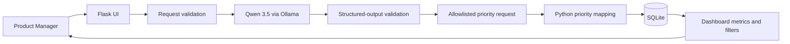
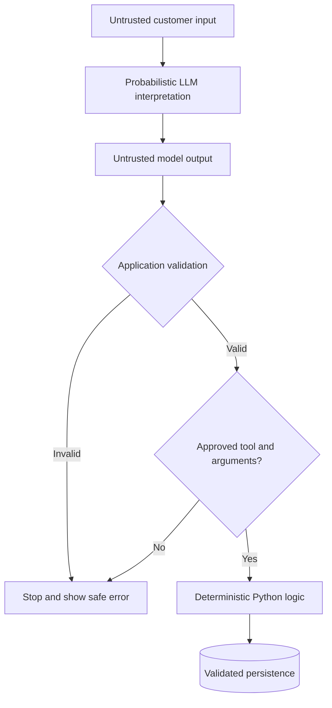
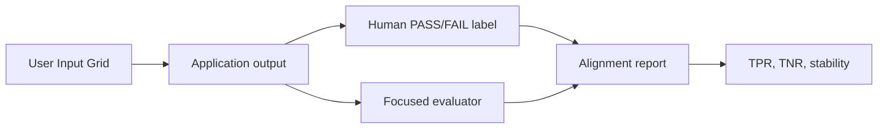
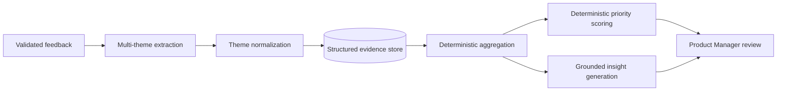

# Technical Architecture

## Scope

This document describes the implemented Customer Empathy Analysis AI MVP and
clearly separates it from the proposed Product PRD V2. The current application
analyzes one feedback item at a time. Multi-theme persistence, normalization,
advanced aggregation, evidence-backed recommendations, and human approval flows
are V2 requirements rather than current behavior.

## Implemented MVP

### Component responsibilities

| Component | Responsibility |
| --- | --- |
| `app.py` | Flask routes, request validation, orchestration, and user-safe errors |
| `llm_service.py` | Ollama calls, structured response validation, controlled retry, and tool-request validation |
| `tools.py` | Deterministic urgency-to-priority mapping |
| `database.py` | Schema creation, parameterized persistence, filtering, sorting, and aggregate counts |
| `templates/` and `static/` | Feedback form and insights dashboard |
| `evals/` | Offline datasets, rubric, failure analysis, shared judge runner, and focused evaluators |
| `tests/` | Deterministic application and evaluator contract tests |

## Single-feedback request flow

1. A Product Manager submits feedback and selects an approved source.
2. Flask rejects empty, oversized, or unsupported input.
3. Qwen returns theme, sentiment, urgency, and summary as JSON.
4. Python validates required fields, enum values, and length limits.
5. Invalid JSON receives one controlled retry; other invalid responses fail safely.
6. Qwen may request only the allowlisted `calculate_priority` tool with the
   urgency value already produced by the analysis.
7. Python maps High, Medium, and Low urgency to P1, P2, and P3.
8. Only a validated analysis is persisted in SQLite.
9. Dashboard counts, filters, and sorting are calculated deterministically.

## Trust and control boundaries

The LLM cannot execute arbitrary tools, write directly to SQLite, change the
priority mapping, or approve its own output. The application owns validation,
business rules, persistence, and failure behavior.

## Evaluation architecture

Evaluation is intentionally separate from the live Flask request path.

`evals/llm_judge.py` provides a reusable local judge runner. Each semantic
criterion receives its own focused prompt, beginning with O1 meaningful theme
extraction. Exact calculations and workflow rules should use code-based checks
instead of an LLM judge.

The judge is not yet a production gate. O1 must first be compared with 20–40
human-labeled outputs and run twice to measure agreement and verdict stability.

## Proposed V2 architecture

PRD V2 extends the system with:

- Multiple themes and per-theme evidence within one feedback item
- Theme normalization against an approved taxonomy
- Explicit and inferred evidence handling
- Duplicate detection and controlled counting
- Deterministic frequency and weighted-priority calculations
- Evidence-backed aggregated insights and recommendations
- Human review for taxonomy changes and critical priority candidates

These components are planned boundaries. They must not be described as existing
application functions until implementation and evaluation are complete.

## Data and privacy

- Model inference runs locally through Ollama.
- The MVP requires no paid LLM API key.
- SQLite data and `.env` are excluded from version control.
- SQL writes and filters use parameterized queries.
- The MVP does not include authentication or multi-user access and should be
  treated as a local pilot rather than an internet-facing production service.

## Current limitations

- One generated theme is stored per feedback item.
- Theme normalization and semantic deduplication are not implemented.
- Aggregation is limited to stored counts and distributions.
- Recommendations and supporting-evidence references are not implemented.
- There is no authentication, deletion workflow, approval audit trail, or
  external integration.
- Local inference latency and quality depend on the installed model and hardware.
